# SuperApp Dolores 🏙️

SuperApp didáctica de Dolores Hidalgo hecha en Flutter: mensajería, monedero, comercio local, transporte, mini-apps, lealtad y métricas de retención en un solo ecosistema. Todo el dominio es Dart puro y los servicios son simulados.

Proyecto hecho con **TDD** (primero la prueba en rojo, luego el código para ponerla en verde) siguiendo el manual de la materia.

## Cómo correr las pruebas

```
flutter test
```

## La app funcionando en el celular

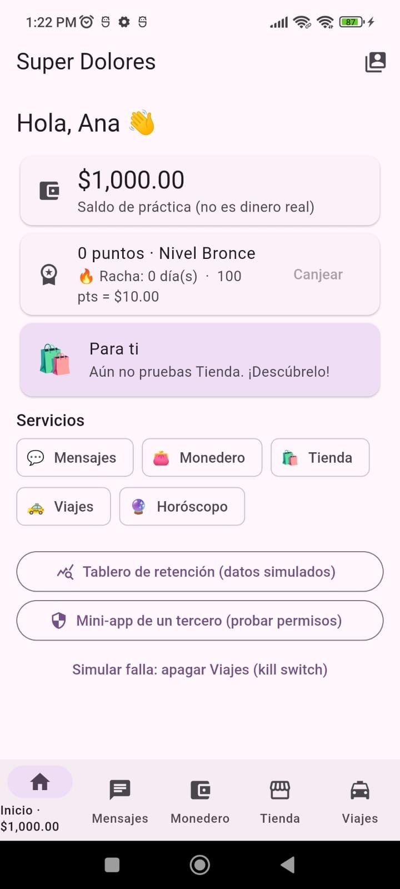

---

## Evidencias TDD (rojo → verde)

**Alumna:** Yaneli Sánchez Cárdenas · **Grupo:** GTID244

Cada ronda muestra primero la prueba en **rojo** (falla porque el código todavía no existe) y después en **verde** (pasa ya con el código hecho).

### Ronda 1

**🔴 Rojo — la prueba falla**

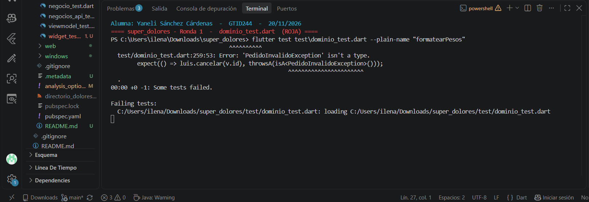

**🟢 Verde — la prueba pasa**

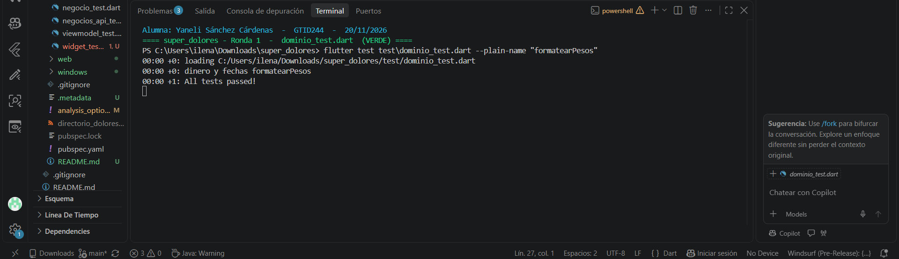

### Ronda 2

**🔴 Rojo — la prueba falla**

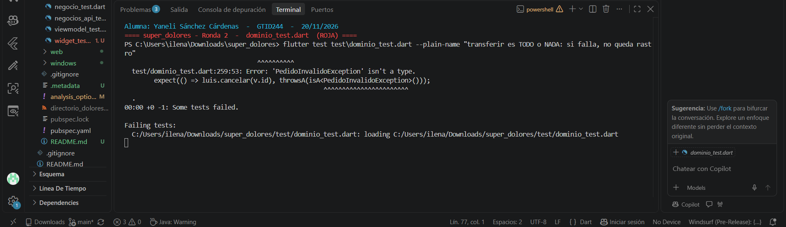

**🟢 Verde — la prueba pasa**

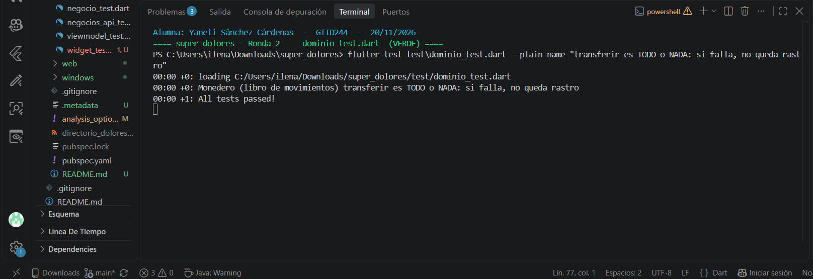

### Ronda 3

**🔴 Rojo — la prueba falla**

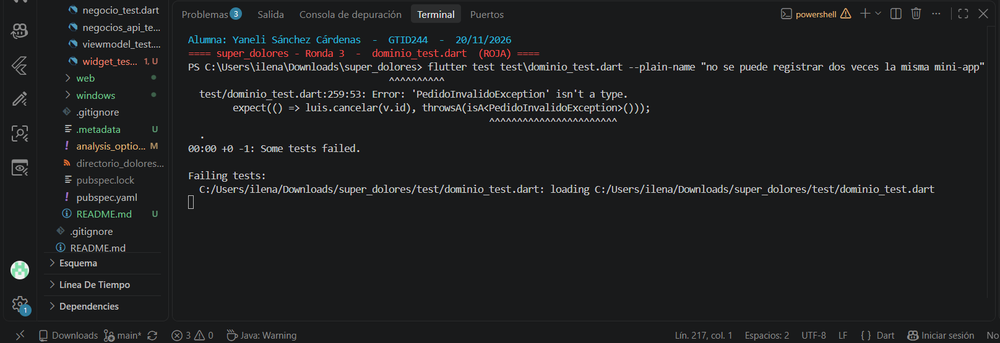

**🟢 Verde — la prueba pasa**

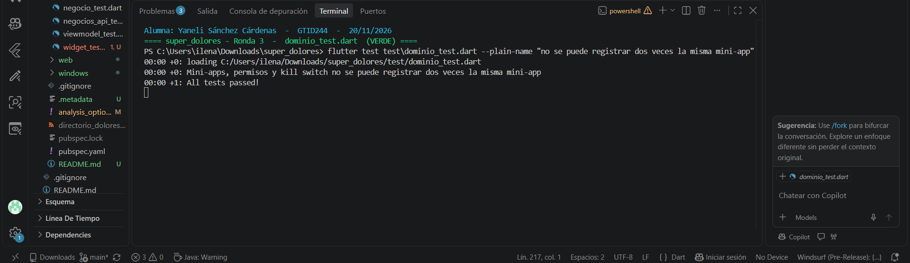

### Ronda 4

**🔴 Rojo — la prueba falla**


**🟢 Verde — la prueba pasa**

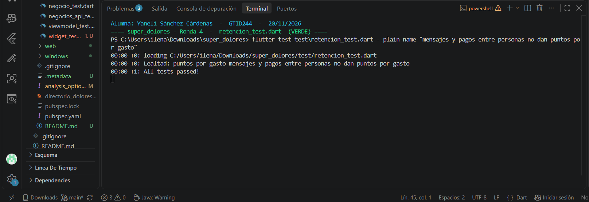

### Ronda 5

**🔴 Rojo — la prueba falla**

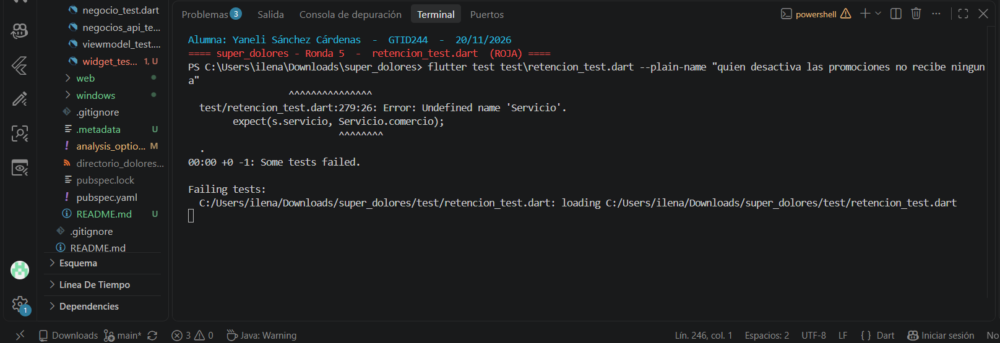

**🟢 Verde — la prueba pasa**

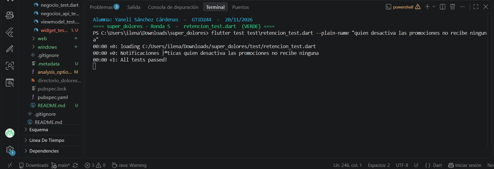

### Ronda 6

**🔴 Rojo — la prueba falla**

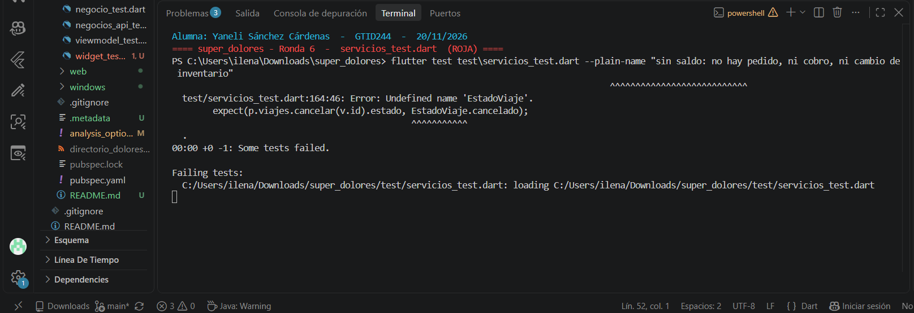

**🟢 Verde — la prueba pasa**

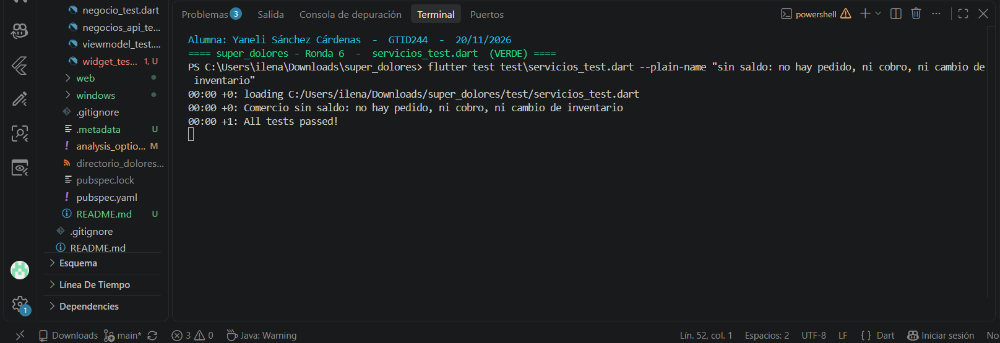

### Ronda 7

**🔴 Rojo — la prueba falla**

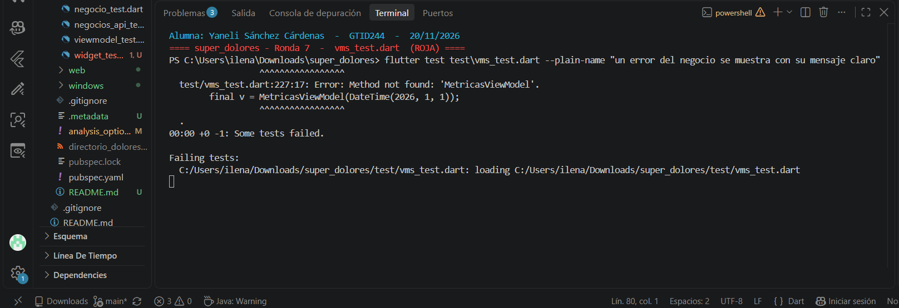

**🟢 Verde — la prueba pasa**

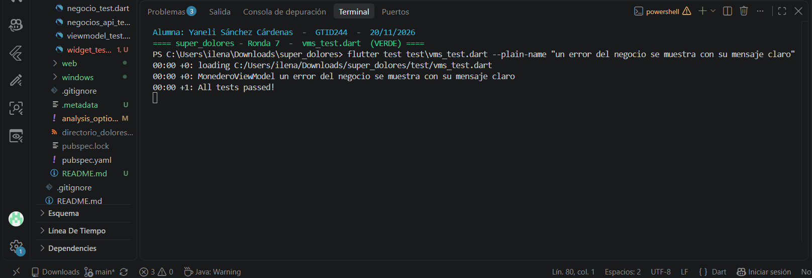

### Ronda 8

**🔴 Rojo — la prueba falla**


**🟢 Verde — la prueba pasa**

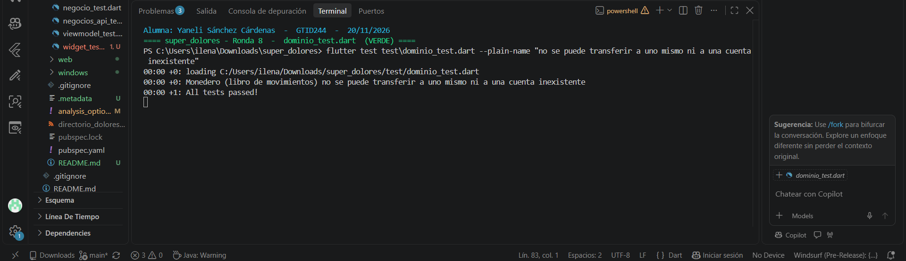

### Ronda 9

**🔴 Rojo — la prueba falla**

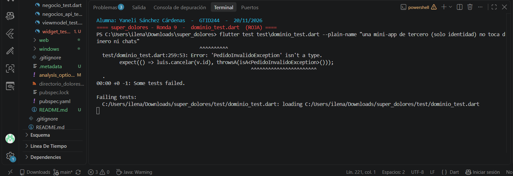

**🟢 Verde — la prueba pasa**

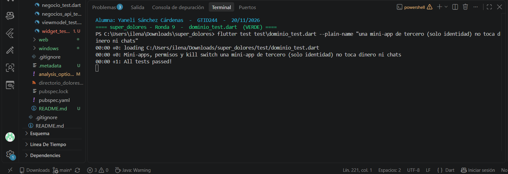

### Ronda 10

**🔴 Rojo — la prueba falla**

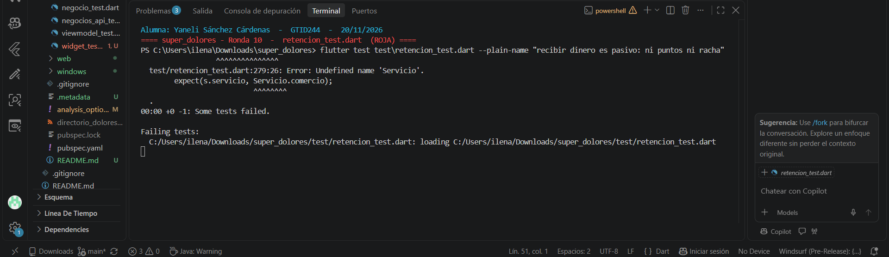

**🟢 Verde — la prueba pasa**

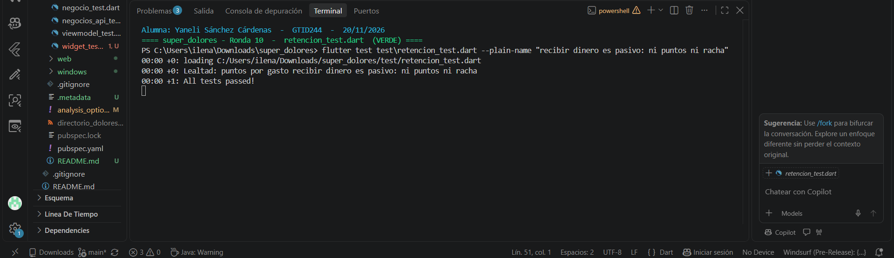

### Ronda 11

**🔴 Rojo — la prueba falla**

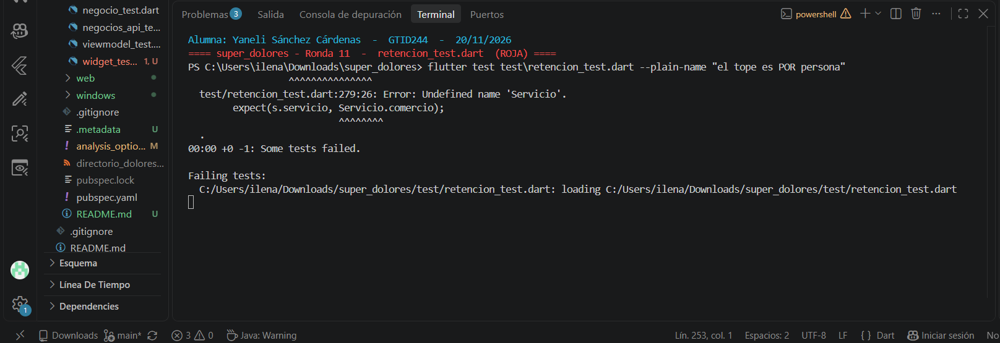

**🟢 Verde — la prueba pasa**

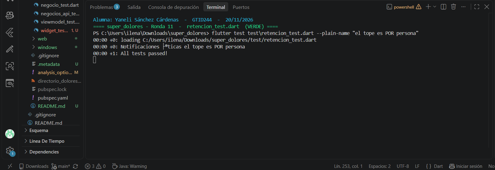

### Ronda 12

**🔴 Rojo — la prueba falla**

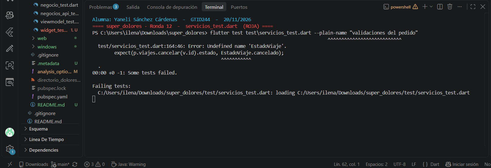

**🟢 Verde — la prueba pasa**

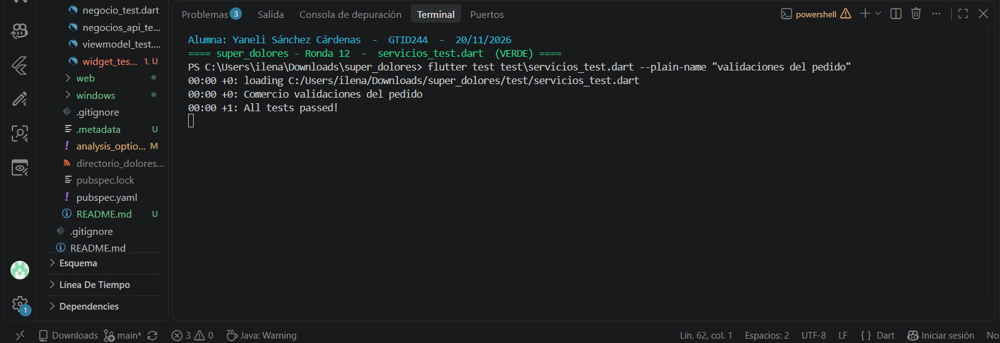
